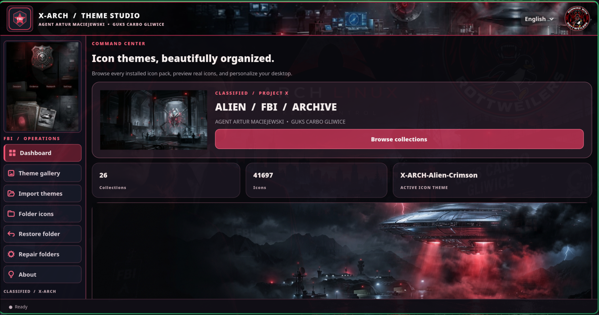

# X-ARCH Theme Studio

**Version 0.1.0-beta**

A desktop theme and folder icon customization application for Linux, featuring a GTK4 graphical interface and a Rust backend.

Developed by **Artur Maciejewski** under the **RUNNING WITH ROTTWEILERS** project.

## Features

- GTK4 desktop interface built with Python and PyGObject.
- Rust backend for theme operations.
- Custom folder icon designs and theme previews.
- FBI-inspired red, white and dark visual styling.
- Theme selection and customization tools.
- Local backup support for theme operations.
- Dedicated application branding and About section.

## Requirements

- Linux desktop environment.
- Fish shell for the installation script.
- Rust toolchain with Cargo for building the backend.
- Python 3 with PyGObject.
- GTK4 and the corresponding GObject introspection bindings.

## Installation

Clone the repository and enter the project directory:

```bash
git clone https://github.com/runningwithrottweilers/xarch-theme-studio.git
cd xarch-theme-studio
```

Run the installer:

```bash
fish install.fish
```

The installer does not require sudo. It will stop if conflicting installation files already exist.

## Test installation

For an isolated installation test:

```bash
fish install.fish --test
fish .install-test/run-test.fish
```

To move the test installation into a backup location:

```bash
fish uninstall.fish --test
```

**Note:** The current uninstaller supports test installations only.

## Building the Rust backend

```bash
cargo build --release
```

## Important notes

- Existing `.directory` files containing absolute icon paths may require manual updates.
- This is a beta release and has not been validated across all Linux distributions.
- Review installation paths and existing files before installing.

## Licensing

Application source code is available under the MIT License. See [LICENSE](LICENSE).

RUNNING WITH ROTTWEILERS branding and graphical assets are subject to separate terms. See [ASSETS-LICENSE.md](ASSETS-LICENSE.md).

## Author

**Artur Maciejewski**

RUNNING WITH ROTTWEILERS

GitHub: https://github.com/runningwithrottweilers

## Screenshots

### X-ARCH Theme Studio — Dashboard


